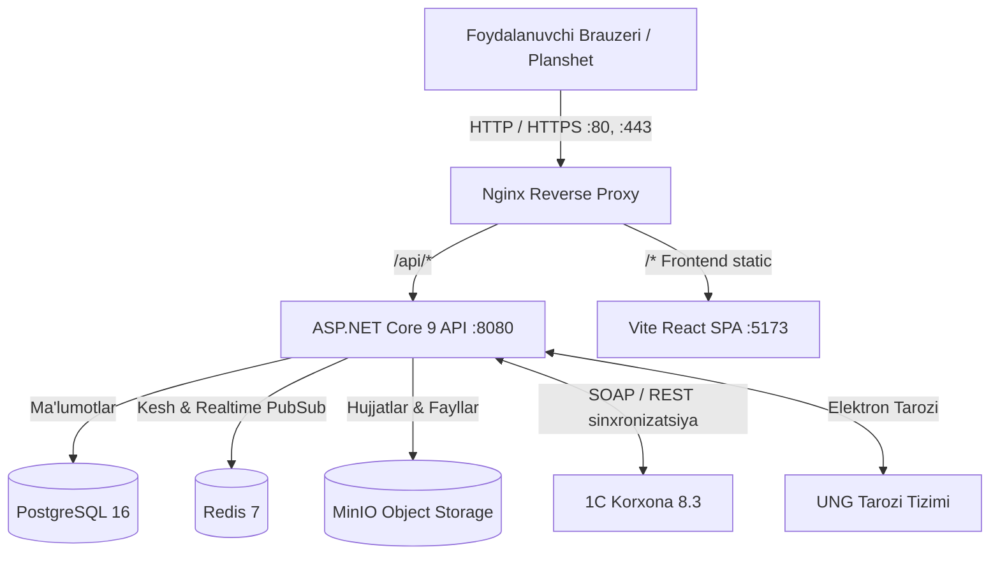

# Texnologik Arxitektura

`E-Transport` zamonaviy **Modulli Monolit (Modular Monolith)** tamoyiliga asoslangan bo‘lib, to‘liq konteynerlashtirilgan (Docker Compose).

---

## 🏛️ Tizim Blok-sxemasi



---

## 🛠️ Texnologiyalar Staki

### 1. Backend
- **Platforma:** .NET 9 (C# 13)
- **Framework:** ASP.NET Core Web API
- **ORM:** Entity Framework Core 9 (Code-First + Migratsiyalar)
- **Autentifikatsiya:** JWT Bearer Token + Role-based Access Control (RBAC)
- **Kesh va Realtime:** Redis 7 (Pub/Sub orqali o‘zgarishlarni darhol yetkazish)
- **Fayllar ombori:** MinIO (S3-compatible storage)

### 2. Frontend
- **Kutubxona:** React 19 + TypeScript
- **Yig‘uvchi (Bundler):** Vite 6
- **Stillashtirish:** Vanilla CSS + Tailwind CSS utilities
- **Ikonkalar:** Lucide React
- **Hujjatlar renderlash:** Brauzer izolyatsiyalangan `iframe` mexanizmi, qat’iy `@page` A4 o‘lchamlari (landscape/portrait)
- **QR generatsiya:** Dinamik vektorli Canvas va SVG QR-kodlar

### 3. Ma'lumotlar Bazasi & Infrastruktura
- **DBMS:** PostgreSQL 16 Alpine
- **Proxy & Web Server:** Nginx Alpine
- **Containerization:** Docker & Docker Compose
- **Sinxronizatsiya:** Fon vazifalari (Background Hosted Services)

---

## 📂 Loyiha Jildlar Strukturasi

```
/var/www/e-transport/
├── docker-compose.yml              # Infrastruktura sozlamalari
├── nginx/                          # Nginx konfiguratsiyasi
├── backend/
│   ├── src/ETransport.Api/         # Web API Host va sozlamalar
│   ├── src/ETransport.Core/        # Entity, DTO, Interfeyslar, Enumlar
│   ├── src/ETransport.Infrastructure/ # DB Context, Repozitoriylar, Integratsiyalar
│   └── src/Modules/                # Modulli biznes domenlar (Marketing, Warehouse...)
└── frontend/
    └── src/
        ├── app/                    # Asosiy router va App kirish nuqtasi
        ├── modules/                # Sahifalar va biznes modullar
        └── shared/                 # Umumiy komponentlar, utils, API mijoz
```

---

## 🔗 Bog‘liq Hujjatlar
- [[03-Backend/Backend-Strukturasi|Backend Arxitekturasi]]
- [[04-Frontend/Frontend-Strukturasi|Frontend Arxitekturasi]]
- [[05-Integratsiyalar-va-DevOps/Docker-va-Server-Sozlamalari|Docker va Deploy]]
