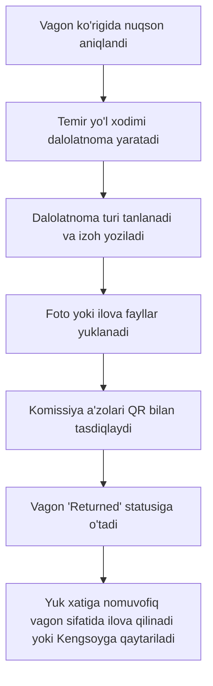

# Nomuvofiqlik va Dalolatnomalar (Defect Acts)

Majmuaga kelgan yoki estakadaga qo‘yilgan vagonlarda turli sabablarga ko‘ra yuklashning imkoni bo‘lmasligi mumkin. Bunday hollarda rasmiy **Dalolatnoma (Defect Act)** rasmiylashtiriladi.

---

## 🛑 Dalolatnoma Turlari (4 xil)

Tizimda 4 xil rasmiy dalolatnoma turi mavjud:

| Kod | Nomi | Sabab va Tavsif |
| :--- | :--- | :--- |
| `sisterna_repair` | **Gaz sisterna ta’mirtalab** | Sisternaning qozoni, armaturasi, klapani yoki yurish qismida nosozlik aniqlangan. |
| `sisterna_no_product`| **Gaz sisterna mahsulot yo‘qligi** | Korxonada yuklash uchun ushbu turdagi gaz/kondensat zaxirasi mavjud emas. |
| `platform_repair` | **Fiting platforma ta’mirtalab** | Platformaning fiting qulflari, ramasi yoki tormoz tizimi shikastlangan. |
| `platform_no_product`| **Fiting platforma mahsulot yo‘q** | Konteynerga joylashtirish uchun tayyor polietilen mahsuloti yetishmaydi. |

---

## 📋 Dalolatnoma Rasmiylashtirish Jarayoni

### Muhim Qoidalar:
1. **Status o‘zgarishi:** Dalolatnoma tuzilgan vagonning statusi `Returned` holatiga o‘tadi.
2. **Yuk xatiga qo‘shish:** Chiqish partiyasi shakllantirilayotganda, nomuvofiq vagonlar umumiy yuklangan vagonlar bilan birga yoki alohida tarkibda Kengsoyga qaytarilishi mumkin.
3. **Chop etish:** Dalolatnoma barcha a’zolar imzolagandan keyin PDF formatida chop etiladi.

---

## 🔗 Bog‘liq Hujjatlar
- [[01-Biznes-Jarayonlar/11-Bosqichli-Vagon-Jarayoni|11 Bosqichli Jarayon]]
- [[02-Modullar/03-Temir-Yol|Temir Yo‘l Moduli]]
